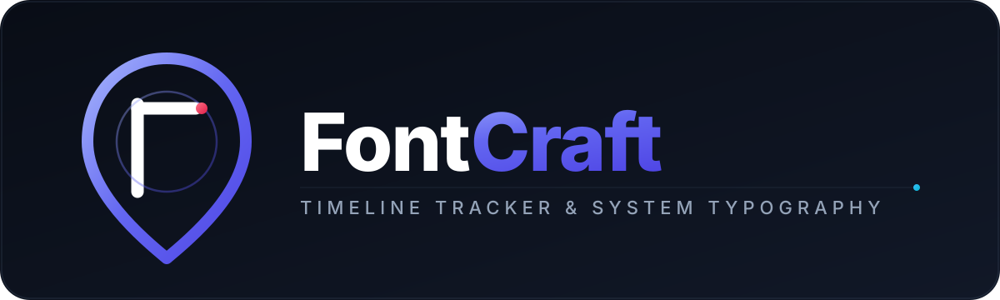

<p align="center">
  
</p>

> **안드로이드 시스템 글꼴 자유 커스텀 & 구글 타임라인 완벽 대용 오프라인 GPK/KML 위치 트래커**

[](https://opensource.org/licenses/Apache-2.0)
[](https://android.com)
[](https://kotlinlang.org)
[](https://developer.android.com/jetpack/compose)

FontCraft는 안드로이드 폰의 서체(글꼴)를 원하는 폰트(TTF, OTF, TTC)로 자유자재로 변경하고, 시스템 자원(배터리/CPU)을 거의 소모하지 않으면서 백그라운드에서 매일 23:59 자동 GPK 보관, 앱 세션 분리 로깅, 갤러리 사진의 EXIF GPS 메타 자동 병렬 색인화, OpenStreetMap 타일 지도 렌더링 및 KML/GeoJSON 내보내기를 완벽 지원하는 차세대 올인원 오픈소스 도구입니다.

---

## ✨ 주요 기능 (Key Features)

### 1. ⚡ 루팅 / 추가 소프트웨어 완전 불필요 (100% Standalone)
- Shizuku나 루팅(su), Magisk 등 외부 프로그램이 전혀 없어도 앱 자체만으로 완벽하게 동작합니다.
- 커스텀 폰트 렌더링, 폰트 파일 패키징 및 내보내기, 백그라운드 GPS 타임라인 기록이 모두 기기 단독으로 완벽히 구동됩니다.

### 2. 🗺️ 구글 타임라인 완벽 대용 (Google Timeline Alternative GPK Engine)
- **초절전 백그라운드 트래킹**: 시스템 자원(배터리/CPU) 소모를 극도로 억제한 적응형 위치 수신 알고리즘 (정지 시 대기, 유의미한 이동 감지 시에만 기록)
- **매일 23시 59분 자동 GPK 보관**: 매일 밤 11시 59분에 그날의 하루 이동 경로를 `daily_YYYY-MM-DD.gpk` 파일로 자동 아카이빙하며, 기록은 1초의 끊김 없이 다음 날로 매끄럽게 이어집니다.
- **앱 실행~종료 세션 전용 별도 분리 기록**: 앱 실행 시작부터 종료될 때까지의 이동 경로는 `session_YYYYMMDD_HHmmss.gpk`로 별도 격리 저장되어 이중 트랙 관리됩니다.
- **내장 인터랙티브 벡터 맵**: 외부 유료 지도 API나 네트워크 없이도 순수 Compose Canvas 기반으로 실시간 이동 경로(Polyline), 체류 지점, 줌/팬 제스처, 거리/속도 통계를 제공합니다.

### 3. 🔤 모든 TTF / OTF / TTC 폰트 완벽 지원 & 실시간 타이포그래피 커스텀
- 기기 내부의 모든 글꼴 파일을 즉시 파싱(Family, Style, 가변 폰트 여부 추출)
- 글꼴 크기 배율, 자간, 행간, 굵기(100~900) 실시간 미세 조정 및 UI 실시간 프리뷰
- 지원 기기 및 고급 사용자를 위한 Magisk/KernelSU 모듈 및 Samsung FlipFont 패키징 지원

### 4. 🛡️ 1-클릭 순정 원상복구 (One-Click Restore)
- 적용된 폰트 모듈 삭제 및 시스템 폰트 렌더링 캐시 초기화 기능 내장으로 언제든 안전하게 순정 상태로 되돌릴 수 있습니다.

---

## 🏗️ 프로젝트 아키텍처 및 디렉토리 구조

```
fontchanger/
├── .github/workflows/
│   └── android-build.yml        # CI/CD: Push/PR 시 자동 APK 빌드 & 아티팩트 업로드
├── app/
│   ├── build.gradle.kts         # 앱 모듈 빌드 스크립트 (Compose, Shizuku, Coroutines)
│   ├── proguard-rules.pro       # 프로가드 난독화 및 최적화 규칙
│   └── src/main/
│       ├── AndroidManifest.xml  # 권한, FileProvider, TTF/OTF 파일 Intent 필터
│       ├── res/                 # 아이콘, 컬러, 다크 테마, XML 리소스
│       └── java/com/openfont/changer/
│           ├── FontCraftApp.kt  # Application 클래스, Shizuku 바인더 확인
│           ├── MainActivity.kt  # 메인 액티비티, 탭 네비게이션 & 인텐트 수신
│           ├── data/
│           │   ├── model/       # FontMetadata, PresetFont, ApplyTarget 모델
│           │   └── repository/  # 프리텐다드, D2Coding, 마루부리 등 프리셋 카탈로그
│           ├── engine/
│           │   ├── FontParser.kt              # TTF/OTF 내부 Name 테이블 바이트 파서
│           │   ├── MagiskModuleGenerator.kt   # Systemless Zip 모듈 패키징 엔진
│           │   ├── SamsungFlipFontBuilder.kt  # One UI FlipFont 패키징 & 가이드
│           │   ├── RootShellExecutor.kt       # su / Shizuku 특권 셸 및 리부트 실행기
│           │   └── BackupRestoreManager.kt    # 모듈 제거 및 폰트 캐시 원상복구 관리자
│           └── ui/
│               ├── theme/       # Material3 테마, 색상, 타이포그래피
│               └── screens/
│                   ├── HomeScreen.kt          # 환경 진단 및 추천 폰트 리스트
│                   ├── CustomFontScreen.kt    # TTF 불러오기 & 실시간 타이포 튜너
│                   ├── ApplyMethodScreen.kt   # 모듈 생성, 공유, 플래시 마법사
│                   └── SettingsScreen.kt      # 순정 복구 & 캐시 청소
├── gradle/libs.versions.toml     # Gradle Version Catalog (최신 의존성 관리)
├── settings.gradle.kts
├── build.gradle.kts
├── CONTRIBUTING.md              # 커밋 컨벤션 (영어 접두어 + 한국어 메시지)
└── LICENSE                      # Apache License 2.0
```

---

## 📦 빌드 및 APK 생성 방법

### 사전 요구 사항
- Android Studio Hedgehog (2023.1.1) 이상 또는 JDK 17 이상
- Android SDK (Compile SDK: 34, Min SDK: 26)

### 로컬 빌드 명령어
```bash
# 저장소 클론
git clone https://github.com/openfont-craft/fontcraft.git
cd fontcraft

# 디버그 APK 빌드 (app/build/outputs/apk/debug/app-debug.apk 생성)
./gradlew assembleDebug

# 릴리즈 APK 빌드
./gradlew assembleRelease
```

### GitHub Actions를 통한 자동 빌드
- 리포지토리에 커밋을 푸시하거나 PR을 생성하면 `.github/workflows/android-build.yml`이 자동으로 실행되어 GitHub Actions Artifacts 탭에서 완성된 APK 파일을 직접 다운로드할 수 있습니다.

---

## 🤝 기여 안내 (Contributing)

이 프로젝트는 오픈소스 커뮤니티의 기여를 환영합니다!
기여 전 [CONTRIBUTING.md](CONTRIBUTING.md)의 **커밋 컨벤션**을 꼭 확인해 주세요.

- 커밋 메시지 규칙: `<type>: <한국어 기능 설명>` (예: `feat: 가변 폰트 축 실시간 조절 슬라이더 추가`)

---

## 📜 라이선스 (License)

FontCraft 프로젝트는 [Apache License 2.0](LICENSE) 하에 배포됩니다.
